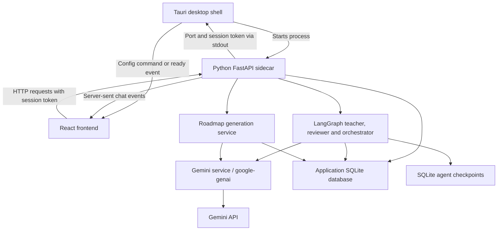

# Architecture: GeminiSensei

This describes the historical source implementation of a retired learning project. It is not a claim that the published desktop packages reproduce the full behavior; see [known limitations](../README.md#known-limitations).

## Components and communication

1. The Rust shell starts the sidecar. Python binds an OS-assigned port on `127.0.0.1` and announces that port and a random session token on stdout.
2. Rust stores those details and exposes them through a Tauri command and a `sidecar-ready` event. The frontend uses this bridge for connection discovery.
3. React then sends application requests **directly to FastAPI over HTTP**, with `X-Sidecar-Token`. Each request is not forwarded through a Rust command.
4. FastAPI routes requests to the roadmap service or initialized agents. Gemini calls pass through the Python `GeminiService`. Chat responses are streamed back as server-sent events.

The frontend uses React 18, TypeScript, Vite, Tailwind CSS and TanStack Query. The desktop shell uses Tauri 2; the sidecar uses Python 3.12+, FastAPI, SQLAlchemy, Alembic and LangGraph. Model names are historical configuration values, not an assurance of current availability.

## State and workflows

Application data lives under the platform-specific `gemini-sensei` user-data directory. The default structured database is `gemini_sensei.db`, managed through async SQLAlchemy sessions and Alembic migrations. The teacher uses `checkpoints.db`; the code reviewer uses `code_reviewer_checkpoints.db`.

- **Teacher:** enrich lesson context, evaluate a guardrail prompt, then generate a Socratic response. Its response prompt currently omits earlier conversation turns despite checkpoint persistence.
- **Reviewer:** enrich context, evaluate a guardrail, analyze code and produce review feedback. Findings and review records use the application database.
- **Orchestrator:** parse commands, select an agent and delegate. It is a routing workflow, not proof of educational mastery.
- **Roadmap service:** ask Gemini for a curriculum, validate its structure with Pydantic, then persist phases and lessons. It is separate from dynamically discovered chat agents.

The registry discovers agents from source directories and loads metadata from `resources/agents.json`. Those filesystem assumptions require explicit handling when freezing Python into an executable. The inspected release omitted these runtime components and migration resources.

## Boundaries that remain unfinished

The token authenticates local API requests, but this prototype is not presented as a hardened desktop product. API keys are stored in a local `.env` file. Current debug logging includes sidecar stdout, CORS is permissive and Tauri CSP is disabled.

The service supports an optional Google Search tool, but teacher generation does not enable it. No semantic retrieval path uses the declared LanceDB dependency. Guardrails are model prompts and can fail open. Streaming framing and history use also need correction before a reliable live demo; those are documented limitations, not completed refactors.
